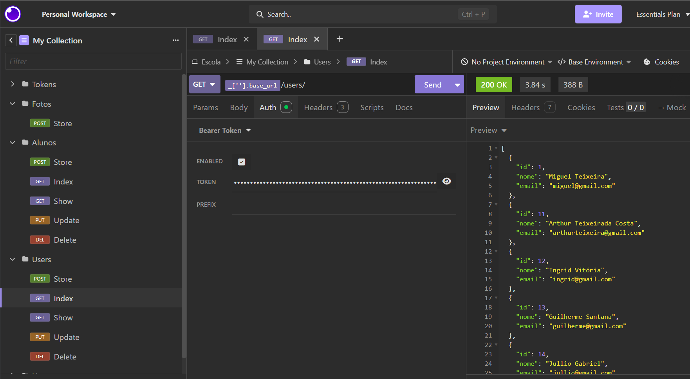
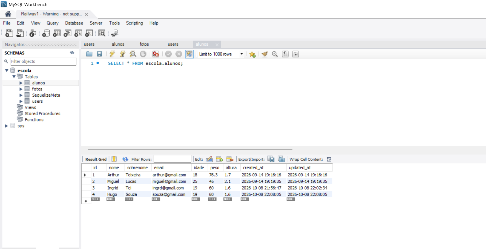
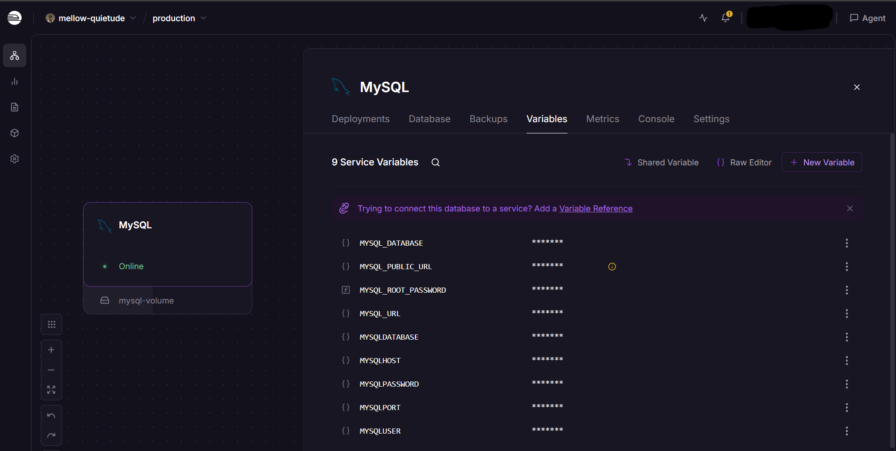
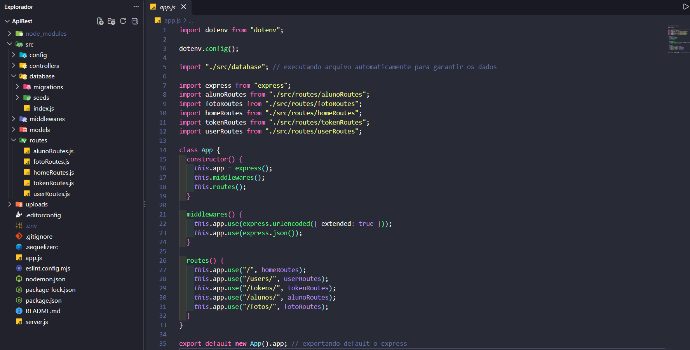
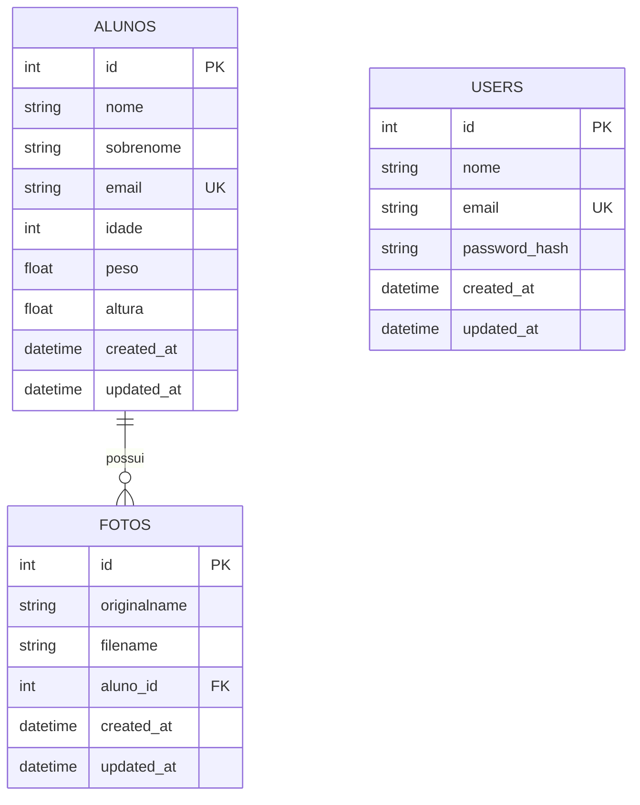

# 🎓 API REST – Escola

Uma API REST para gerenciamento de **alunos** e **fotos de alunos**, desenvolvida com Node.js e Express, com autenticação de usuários via **JWT** e um CRUD completo.

O acesso às rotas de escrita é protegido: para criar, editar ou excluir dados, o usuário precisa estar autenticado e enviar o token em cada requisição.

---

## 📖 Sobre o Projeto

A **API Escola** foi desenvolvida com o objetivo de colocar em prática conceitos de desenvolvimento Back-end, principalmente a construção de APIs utilizando Express.js, integração com MySQL através de um ORM e operações de CRUD.

A aplicação permite que usuários façam login, gerenciem o cadastro de alunos e enviem fotos vinculadas a cada aluno.

Além do CRUD, o projeto também conta com autenticação, criptografia de senhas, validações de dados, upload de arquivos, versionamento do banco com migrations e organização do código seguindo o padrão MVC.

A API devolve apenas JSON, podendo ser consumida por qualquer front-end (React, Vue, mobile) ou testada diretamente com ferramentas como o Insomnia.

---

## 📸 Demonstração

### 🧪 Testando as rotas no Insomnia

Todas as rotas foram organizadas em uma coleção (Tokens, Fotos, Alunos e Users) e testadas com autenticação **Bearer Token**.

<p align="center">
  
</p>

### 🗄️ Banco de dados no MySQL Workbench

Estrutura criada pelas migrations (`alunos`, `fotos`, `users` e a tabela de controle `SequelizeMeta`) e dados cadastrados pela API.

<p align="center">
  
</p>

### ☁️ Banco de dados hospedado no Railway

O MySQL roda na nuvem pelo Railway, com volume persistente e variáveis de ambiente de conexão.

<p align="center">
  
</p>

### 💻 Organização no VS Code

<p align="center">
  
</p>

> Todos os dados exibidos nas imagens são fictícios.

---

## 🚀 Tecnologias Utilizadas

### ⚙️ Back-end
- **Node.js** — ambiente de execução JavaScript, roda todo o servidor.
- **Express 5** — framework utilizado na construção do servidor, das rotas e dos middlewares. Interpreta JSON e formulários com `express.json()` e `express.urlencoded()`.
- **Sucrase** — transpilador que permite usar `import/export` (ES Modules) sem configuração extra. O `nodemon.json` executa os arquivos com `node -r sucrase/register`.
- **Nodemon** — reinicia o servidor automaticamente a cada alteração (`npm run dev`).
- **Multer** — recebe a foto do aluno via `multipart/form-data`, valida o tipo (PNG/JPG) e salva na pasta `uploads/` com nome único baseado em `Date.now()`.
- **dotenv** — carrega os dados sensíveis (banco e segredo do JWT) do arquivo `.env`.

### 🗄️ Banco de Dados
- **MySQL** — banco relacional que guarda `users`, `alunos` e `fotos`.
- **Sequelize (ORM)** — os *models* `User`, `Aluno` e `Foto` mapeiam as tabelas para classes JavaScript. As consultas usam métodos como `findAll`, `findByPk`, `create`, `update` e `destroy`, sem escrever SQL manualmente.
- **mysql2** — driver que conecta o Sequelize ao MySQL.
- **Sequelize CLI** — gerencia **migrations** (versionamento da estrutura do banco) e **seeds** (dados iniciais). O `.sequelizerc` define onde ficam esses arquivos.
- **Railway** — hospedagem do MySQL na nuvem.

Configurações importantes (`src/config/database.js`):
- Colunas em `snake_case` e timestamps automáticos (`created_at` / `updated_at`).
- Fuso horário `America/Sao_Paulo`.
- Chave estrangeira `fotos.aluno_id` com `ON DELETE SET NULL` e `ON UPDATE CASCADE`.

### 🔐 Autenticação e Segurança
- **bcryptjs** — hash das senhas. Um hook `beforeSave` no model `User` gera o `password_hash`, e o campo `password` é `VIRTUAL`, ou seja, nunca é salvo no banco.
- **jsonwebtoken (JWT)** — no login (`POST /tokens`), o servidor confere e-mail e senha e devolve um token assinado com `TOKEN_SECRET`, com `id`, `email` e tempo de expiração definido em `TOKEN_EXPIRATION`.
- **Middleware `loginRequired`** — lê o header `Authorization: Bearer <token>`, valida o JWT e **consulta o usuário no banco** comparando `id` e `email`. Se o e-mail mudar, o token antigo deixa de valer.
- **Autorização por dono** — atualização e exclusão de usuário usam o `req.userId` extraído do token, então cada usuário só altera os próprios dados.
- **Validação de dados** — o Sequelize valida tamanho de nome, formato de e-mail, tipos numéricos e e-mails únicos antes de gravar.
- **Validação de upload** — o Multer só aceita `image/png` e `image/jpeg`.
- **Proteção de dados sensíveis** — `.env` e `node_modules` ficam fora do Git, e as respostas de usuário devolvem apenas `id`, `nome` e `email`, nunca o hash.

### 🧰 Ferramentas
- **VS Code** — editor de código.
- **Insomnia** — testes das rotas da API.
- **MySQL Workbench** — visualização e consulta do banco de dados.
- **Git e GitHub** — controle de versão.
- **ESLint e EditorConfig** — padronização de código (indentação, aspas, fim de linha) independente do editor ou do sistema operacional.

---

## ✨ Funcionalidades

### 👤 Usuários
- Login com geração de token JWT
- Criação de novos usuários (rota protegida)
- Atualização e exclusão dos próprios dados
- Autenticação através de token
- Proteção das rotas que exigem login
- Validação dos dados fornecidos
- Senhas armazenadas de forma protegida através de hash

### 🧑‍🎓 Alunos
A aplicação possui um CRUD completo:

- ➕ **Create** — cadastrar novos alunos (nome, sobrenome, e-mail, idade, peso e altura)
- 👁️ **Read** — listar todos os alunos ou consultar um aluno específico, já com as fotos
- ✏️ **Update** — editar as informações de um aluno
- 🗑️ **Delete** — excluir um aluno

### 🖼️ Fotos
- Upload de foto (PNG ou JPG) vinculada a um aluno
- Um aluno pode ter várias fotos
- Mensagens de erro padronizadas no formato `{ "errors": ["..."] }`

### 🛣️ Endpoints

| Método | Rota | Protegida | Descrição |
| --- | --- | :---: | --- |
| `GET` | `/` | ❌ | Rota inicial (teste de funcionamento) |
| `POST` | `/tokens` | ❌ | Login: recebe `email` e `password` e retorna o token |
| `POST` | `/users` | ✅ | Cria um novo usuário |
| `PUT` | `/users` | ✅ | Atualiza o usuário logado |
| `DELETE` | `/users` | ✅ | Exclui o usuário logado |
| `GET` | `/alunos` | ❌ | Lista todos os alunos (mais recentes primeiro) com fotos |
| `GET` | `/alunos/:id` | ❌ | Mostra um aluno com suas fotos |
| `POST` | `/alunos` | ✅ | Cria um aluno |
| `PUT` | `/alunos/:id` | ✅ | Atualiza um aluno |
| `DELETE` | `/alunos/:id` | ✅ | Remove um aluno |
| `POST` | `/fotos` | ✅ | Envia uma foto (`multipart/form-data`, campos `foto` e `aluno_id`) |

### 🔎 Exemplos rápidos

**Login**
```bash
curl -X POST http://localhost:3001/tokens \
  -H "Content-Type: application/json" \
  -d '{"email": "seu@email.com", "password": "suasenha"}'
```
Resposta:
```json
{ "token": "eyJhbGciOiJIUzI1NiIsInR5cCI6IkpXVCJ9..." }
```

**Criar aluno**
```bash
curl -X POST http://localhost:3001/alunos \
  -H "Authorization: Bearer SEU_TOKEN" \
  -H "Content-Type: application/json" \
  -d '{"nome": "Maria", "sobrenome": "Silva", "email": "maria@email.com", "idade": 20, "peso": 60.5, "altura": 1.65}'
```

**Enviar foto**
```bash
curl -X POST http://localhost:3001/fotos \
  -H "Authorization: Bearer SEU_TOKEN" \
  -F "foto=@/caminho/da/imagem.jpg" \
  -F "aluno_id=1"
```

---

## 📂 Estrutura do Projeto

```
escola-APIREST/
│
├── docs/
│   └── images/
│
├── src/
│   ├── config/
│   │   ├── database.js
│   │   └── multerConfig.js
│   ├── controllers/
│   │   ├── AlunoController.js
│   │   ├── FotoController.js
│   │   ├── HomeController.js
│   │   ├── TokenController.js
│   │   └── UserController.js
│   ├── database/
│   │   ├── migrations/
│   │   ├── seeds/
│   │   └── index.js
│   ├── middlewares/
│   │   └── loginRequired.js
│   ├── models/
│   │   ├── Aluno.js
│   │   ├── Foto.js
│   │   └── User.js
│   └── routes/
│       ├── alunoRoutes.js
│       ├── fotoRoutes.js
│       ├── homeRoutes.js
│       ├── tokenRoutes.js
│       └── userRoutes.js
│
├── uploads/
│
├── .editorconfig
├── .env
├── .gitignore
├── .sequelizerc
├── app.js
├── eslint.config.mjs
├── nodemon.json
├── package.json
├── package-lock.json
└── server.js
```

### Organização
- **controllers/** — contém a lógica responsável pelo funcionamento de cada recurso (alunos, fotos, usuários e login).
- **middlewares/** — middleware que valida o token JWT nas rotas protegidas.
- **models/** — modelos que representam as tabelas do banco e suas validações.
- **routes/** — define qual método HTTP e URL chama qual método do controller.
- **config/** — configurações do banco de dados e do upload de imagens.
- **database/** — conexão com o banco, migrations e seeds.
- **uploads/** — pasta onde as fotos enviadas são armazenadas.
- **app.js** — configuração do Express (middlewares e rotas).
- **server.js** — inicialização do servidor.

### Como cada arquivo foi usado

**Raiz do projeto**
- `server.js` — importa o `app` e o coloca para escutar na porta `3001`.
- `app.js` — carrega o `dotenv`, conecta ao banco, cria a classe `App`, registra os middlewares e monta as rotas em seus prefixos.
- `nodemon.json` — faz o nodemon executar os arquivos com `sucrase/register`, habilitando `import/export`.
- `.sequelizerc` — informa ao Sequelize CLI onde estão config, models, migrations e seeds.
- `.env` — guarda as credenciais do banco, `TOKEN_SECRET` e `TOKEN_EXPIRATION`.
- `eslint.config.mjs` e `.editorconfig` — padronizam o código.
- `.gitignore` — impede o envio de `node_modules` e `.env` ao repositório.

**`src/config/`**
- `database.js` — dialeto MySQL, credenciais vindas do `.env`, timestamps em `snake_case` e fuso `America/Sao_Paulo`.
- `multerConfig.js` — filtro que aceita só PNG/JPG e armazenamento em disco com nome `timestamp + extensão`.

**`src/database/`**
- `index.js` — cria a conexão Sequelize, inicializa os models `Aluno`, `User` e `Foto` e executa as associações.
- `migrations/…-alunos.js` — cria a tabela `alunos`.
- `migrations/…-users.js` — cria a tabela `users` com e-mail único.
- `migrations/…-mudar-email-aluno-unique.js` — torna única a coluna `email` de `alunos`.
- `migrations/…-criar-tabela-de-foto-do-aluno.js` — cria `fotos` com chave estrangeira para `alunos`.
- `seeds/…-criar-usuarios.js` — insere usuários iniciais já com a senha criptografada.

**`src/models/`**
- `User.js` — campos, validações, campo virtual `password`, hook de hash com bcrypt e método `passwordIsValid()`.
- `Aluno.js` — campos e validações do aluno e relação `hasMany` com `Foto`.
- `Foto.js` — campos da foto e relação `belongsTo` com `Aluno`.

**`src/controllers/`**
- `HomeController.js` — resposta simples para testar o servidor.
- `TokenController.js` — valida as credenciais e gera o JWT.
- `UserController.js` — cria, atualiza e exclui usuários, devolvendo só `id`, `nome` e `email`.
- `AlunoController.js` — CRUD completo de alunos, incluindo as fotos nas consultas.
- `FotoController.js` — executa o Multer, grava o registro da foto e vincula ao aluno.

**`src/middlewares/` e `src/routes/`**
- `loginRequired.js` — barra requisições sem token ou com token inválido/expirado e injeta `req.userId` e `req.userEmail`.
- `*Routes.js` — mapeiam `método + URL` para o método do controller, aplicando `loginRequired` onde necessário.

### 🧩 Modelo do banco de dados



---

## 💻 Como Executar

### Pré-requisitos

Antes de começar, você precisa ter:

- Node.js
- MySQL (instalado localmente ou um banco na nuvem, como o Railway)
- Git
- (Opcional) Insomnia ou Postman para testar as rotas

### 1. Clone o repositório
```bash
git clone https://github.com/ArthurTeix/API-REST-js.git
```

### 2. Acesse o diretório
```bash
cd API-REST-js
```

### 3. Instale as dependências
```bash
npm install
```

### 4. Prepare o banco de dados

**Opção A: MySQL local**

```sql
CREATE DATABASE escola CHARACTER SET utf8mb4 COLLATE utf8mb4_unicode_ci;
```

**Opção B: MySQL no Railway**

1. Crie um projeto no [Railway](https://railway.com/) e adicione um serviço **MySQL**.
2. Abra a aba **Variables** do serviço e copie os valores de `MYSQLHOST`, `MYSQLPORT`, `MYSQLUSER`, `MYSQLPASSWORD` e `MYSQLDATABASE`.
3. Para conectar de fora do Railway (da sua máquina ou do Workbench), use o host e a porta **públicos** do serviço (`MYSQL_PUBLIC_URL`).

### 5. Configure as variáveis de ambiente

Crie um arquivo `.env` na raiz do projeto:

```env
DATABASE=nome_do_banco
DATABASE_HOST=host_do_banco
DATABASE_PORT=porta_do_banco
DATABASE_USER=usuario_do_banco
DATABASE_PASSWORD=senha_do_banco

TOKEN_SECRET=uma_frase_longa_e_aleatoria_aqui
TOKEN_EXPIRATION=7d
```

Substitua os valores pelos dados da sua configuração do MySQL.

### 6. Crie a pasta de uploads (caso não exista)
```bash
mkdir uploads
```

### 7. Execute as migrations (cria as tabelas)
```bash
npx sequelize db:migrate
```

### 8. Execute os seeds (cria usuários de teste)
```bash
npx sequelize db:seed:all
```

Os usuários de teste estão em `src/database/seeds/`. Como a criação de usuários exige login, o seed é o ponto de partida para obter o primeiro token.

### 9. Inicie o servidor
```bash
npm run dev
```

Após iniciar o servidor, acesse:

```
http://localhost:3001
```

### Testando

1. Faça `POST /tokens` com um usuário do seed para obter o token.
2. Nas rotas protegidas, envie o header `Authorization: Bearer <token>`.
3. Crie um aluno em `POST /alunos` e depois envie uma foto em `POST /fotos`.

### Comandos úteis

- `npm run dev` — inicia o servidor com nodemon.
- `npx sequelize db:migrate` — aplica as migrations.
- `npx sequelize db:migrate:undo` — desfaz a última migration.
- `npx sequelize db:seed:all` — executa todos os seeds.

---

## 📚 O que aprendi

O desenvolvimento deste projeto foi uma oportunidade para colocar em prática conceitos importantes do desenvolvimento Back-end.

Durante o desenvolvimento, pude aprofundar meus conhecimentos em:

- Construção de APIs utilizando Express.js
- Criação e organização de rotas seguindo o padrão MVC
- Desenvolvimento de um CRUD completo
- Integração entre Express e MySQL
- Utilização do Sequelize para modelagem, validação e relacionamentos (`hasMany` / `belongsTo`)
- Migrations e seeds para versionar e recriar o banco em qualquer máquina
- Autenticação com JWT e geração de tokens
- Hash de senhas utilizando bcrypt e campos `VIRTUAL`
- Criação e utilização de middlewares para proteger rotas
- Upload de arquivos com Multer, incluindo filtro de tipo e nome único
- Validação e tratamento de erros, com respostas padronizadas
- Utilização de variáveis de ambiente
- Hospedagem de banco de dados na nuvem com Railway
- Testes de API com Insomnia e consulta de dados com MySQL Workbench
- Verbos HTTP e códigos de status (`GET`, `POST`, `PUT`, `DELETE`, `400`, `401`)
- Padronização de código com ESLint e EditorConfig
- Aplicação de práticas de segurança em APIs

---

## 🎯 Objetivo do Projeto

Este projeto foi desenvolvido principalmente como forma de praticar e consolidar conhecimentos em desenvolvimento Back-end, especialmente na construção de APIs utilizando Node.js, Express e MySQL.

Também serve como base para um futuro front-end (por exemplo, em React) que consuma esta API, funcionando como uma etapa importante na minha evolução como desenvolvedor.


---

## 👨‍💻 Autor

Desenvolvido por **Arthur Teixeira**

[](https://www.linkedin.com/in/arthurteix/)
